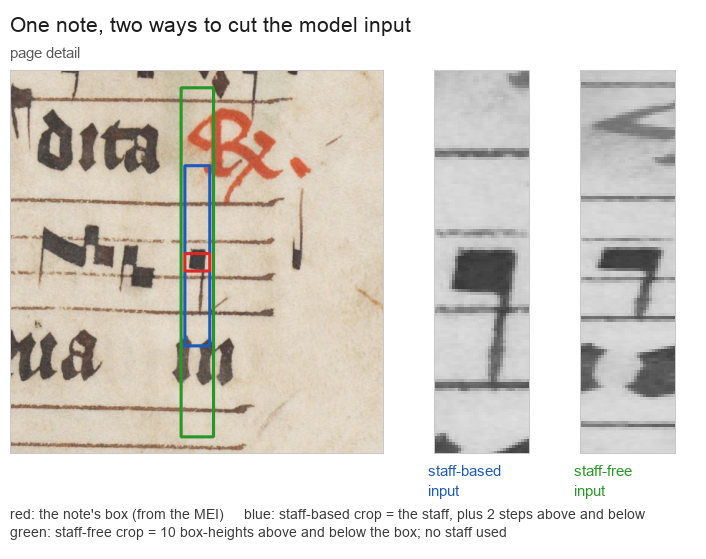
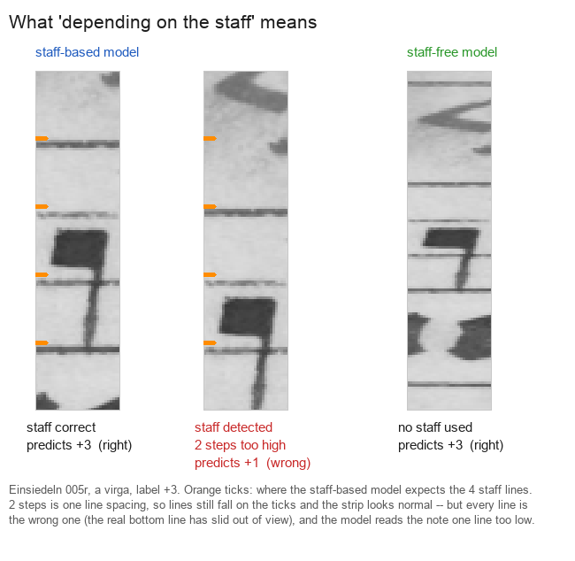

# v2 stave-step CNN: square notation

**Status: first round done** (issue #5). Single-note neumes only; multi-note
neumes are in `../v3-multinote/` (#6).

v1 (`../v1-hfngl/`) trained a small CNN to predict a note's stave step from an
image crop, on 13 hand-labelled Hufnagel pages. v2 moves it to square notation,
with ground truth taken from DDMAL's corrected OMR output (MEI) instead of hand
labels, and adds a variant that never uses staff lines: the crop is cut around
the note's box alone and the model finds the staff in the image itself.

Stave step, as in v1: the bottom staff line is 0, each line up adds 2, spaces
are odd.

## Layout

**Data** (`dataset/`):

| File | Purpose |
|---|---|
| `fetch_sources.py` | downloads the MEI (`e2e-omr-resources`) and, with `--images`, the page images (HF `DDMAL-lab/All-Images`, private) into the repo's gitignored `data/` |
| `build_dataset.py` | one row per note (box, staff, label) in `notes.csv`, one per page in `pages.csv`, the page-level split, `stats.txt` |
| `build_crops.py` | caches one crop per note in `data/v2_crops*/`: `--mode staff` (v1's rule), `bbox` (staff-free) or `icbox` (staff-free on IC-style boxes, plus a box mask); `--manuscripts` rebuilds only some manuscripts' caches |
| `show_crops.py` | sample grid of cached crops, to eyeball them before training |

**Model** (this folder):

| File | Purpose |
|---|---|
| `model.py` | v1's `StepCNN` / `StepCNNClassifier`, classes widened to steps -3..9 |
| `data.py` | loads the crop cache; augmentation on the GPU (v1's recipe) |
| `train.py` | trains the configurations in `CONFIGS`, keeps the best-on-val epoch in `checkpoints/` |
| `eval_cached.py` | test accuracy of every checkpoint, per manuscript and neume class |
| `eval_robustness.py` | re-cuts the test crops under controlled staff errors (staff models) or box errors (staff-free models) |
| `eval_ood.py` | the same models on Salzinnes, a manuscript none was trained on |
| `show_inputs.py`, `show_box_shift.py` | figures: how a crop is cut; what a 1-step box error does |
| `make_readme_figures.py` | the two figures in this README (`figures/readme/`) |

**Ground-truth checks** (`mei_groundtruth_check/`): how the MEI was verified
against the page images before use, with its own README.

Rendered figures are gitignored (they are drawn on page images from a private
dataset), except the two in `figures/readme/` used below.

## Data

| Manuscript | MEI (`e2e-omr-resources/resulting_mei_files/`) | Pages | Usable notes |
|---|---|---|---|
| Einsiedeln, CH-E 611 | `Reviewed no pitch correction needed` (pitches) + `Processed` (boxes), and `Reviewed_once` | 552 | 285,614 |
| MS73, CDN-Mlr MS73 | `Processed` | 282 | 28,915 |

What the checks found (details in `mei_groundtruth_check/README.md`):

- Einsiedeln's Reviewed note boxes were dragged up an octave in Neon when the
  C-clef octave was fixed, so boxes come from Processed (pre-drag), matched by
  xml:id. A blind check of 200 boxes puts errors at about 6% (about 1% outside
  ligatures).
- `Reviewed_once` (264 more Einsiedeln pages) still reads C clefs as C3 but
  was never dragged; `build_dataset.py` reads each page's convention off its
  own geometry and raises the octave where needed.
- MS73's coordinates are half the image size on 277 pages; each page is
  scaled by its own image size over its MEI size (1.0 on page 142, 3.23 on
  40 / 94 / 102, 2.01-2.04 on 39 / 166), and page 23, whose MEI was drawn on
  another scan, has its notes excluded. Half its boxes have zero height (given
  the page's median size).
- Under 0.5% of notes are dropped (invalid clef lines, no box, implausible
  steps), plus one MS73 page uploaded twice.

**Split**: by page, 70 / 15 / 15 per manuscript, seed 42 (`pages.csv`). This
round uses single-note neumes:

| | train | val | test |
|---|---|---|---|
| Einsiedeln pages | 386 | 83 | 83 |
| MS73 pages | 198 | 42 | 42 |
| Single-note neumes | 76,218 | 15,868 | 15,589 |

## Input



Both crops are 128 × 32 grayscale; horizontally, both span the note's box.

- **Staff-based** (v1's rule): from 2 steps above the top staff line to 2 steps
  below the bottom one, using the MEI's staff zones. The 4 lines land on the
  same rows in every crop.
- **Staff-free**: centred on the note's box, 10 units up and down, a unit being
  the page's median note-box height (one step to within a few percent on both
  manuscripts). The whole staff is always inside; no staff geometry is used.

Augmentation (p = 0.75): vertical scale ±20%, rotation ±4°, brightness ±15%,
Gaussian noise σ = 0.03, and a vertical shift: ±15% of the window for staff
crops (v1), ±0.5 or ±1.5 steps for staff-free crops.

Why the staff-free variant matters: a staff-based crop is only as good as the
staff it is cut from. When staff detection is off by a whole line position, the
strip still looks like a normal staff, and the model counts from the wrong line.



## Model and training

v1's architecture unchanged: three 3 × 3 convolutions (16, 32, 64 channels,
two max-pools), adaptive average pooling to 8 vertical bins, dropout 0.3,
FC 512 → 64 → 13 classes. 56,973 parameters (regression head: 56,193).

Adam (lr 1e-3, weight decay 1e-4), batch 128, 30 epochs, best val epoch kept.
About 7 minutes per model on a Mac GPU (MPS).

## Results

Test set, exact step, single-note neumes (15,589):

| Model | All | Einsiedeln | MS73 | Within 1 step |
|---|---|---|---|---|
| Staff-based regression | 98.1% | 98.1% | 97.4% | 99.7% |
| Staff-based regression + aug | 97.8% | 97.8% | 97.7% | 99.7% |
| Staff-based classification | 99.2% | 99.2% | 99.4% | 99.8% |
| **Staff-based classification + aug** | **99.1%** | 99.1% | 99.5% | 99.8% |
| Staff-free, ±0.5-step box jitter | 98.9% | 99.2% | 95.6% | 99.5% |
| Staff-free, same at 256 × 32 | 99.0% | 99.3% | 95.4% | 99.5% |
| **Staff-free, ±1.5-step box jitter** | **98.8%** | 99.0% | 96.6% | 99.4% |
| Staff-free, simulated IC boxes | 98.6% | 98.7% | 97.2% | 99.4% |
| Staff-free, IC boxes + box-mask channel | 98.5% | 98.8% | 94.7% | 99.3% |

**Robustness** (`eval_robustness.py`, test set, all notes):

| Staff-based classification + aug, staff error | Accuracy |
|---|---|
| none | 99.1% |
| shifted 0.5 / 1 step | 99.0% / 99.0% |
| shifted 2 steps | 37.6% |
| line spacing ×0.8 / ×1.2 / ×1.5 | 98.3% / 98.2% / 51.5% |
| top / bottom line missed | 96.1% / 95.7% |

| Staff-free, box error | none | 0.5 step | 1 step | scale ×0.8 / ×1.2 |
|---|---|---|---|---|
| ±0.5-step jitter | 98.9% | 98.4% | 92.9% | 98.3% / 97.9% |
| ±1.5-step jitter | 98.8% | 98.6% | 98.4% | 97.1% / 97.2% |
| simulated IC boxes | 98.6% | 98.4% | 96.9% | 97.6% / 97.2% |
| IC boxes + box mask | 98.5% | 97.5% | 82.4% | 97.2% / 97.0% |

**Unseen manuscript** (`eval_ood.py`): Salzinnes (CDN-Hsmu M2149.L4), 6 pages,
574 single-note neumes. Staff-based classification + aug 100%, staff-free
±1.5-step 100%; no model scores below its test result.

**Takeaways**

- As in v1, classification beats regression.
- The staff-based model tolerates staff errors up to a step but collapses at a
  whole line position (2 steps) or 50% spacing error -- the errors our current
  staff detection makes on Einsiedeln.
- The staff-free model is nearly as accurate without any staff geometry. With
  ±0.5-step jitter it reads "the middle of the strip" and follows a misplaced
  box; ±1.5-step jitter teaches it to find the nearest notehead.
- The box-mask variant trusts the box: its augmentation moves image and mask
  together, so box and ink are always aligned in training. Not a fair test of
  the idea until the mask is jittered on its own.

## Reproducing

Needs numpy, opencv-python, torch, scipy and Pillow. From this folder:

```
cd dataset
HF_TOKEN=<token with DDMAL-lab access> python fetch_sources.py --images   # ~6 GB into ../../../data/
python build_dataset.py
python build_crops.py
python build_crops.py --mode bbox --img-h 128 --single-note-only
python build_crops.py --mode bbox --img-h 256 --single-note-only
python build_crops.py --mode icbox --img-h 128 --single-note-only
cd ..
python train.py                     # every configuration; --only <name> for one
python eval_cached.py
python eval_robustness.py
python eval_ood.py                  # Salzinnes MEI and images: see its docstring
```

`checkpoints/` already holds the trained weights, so the evaluation scripts
run without retraining.

## Limitations and next steps

- Boxes come from the MEI, not from IC as in the real pipeline; Einsiedeln's
  and Salzinnes' boxes were placed by Neon from the pitch. The staff-free model
  needs testing on real IC boxes.
- No comparison with other methods yet: running the heuristic pitch finder on
  MEI boxes would be unfair, since their positions encode the pitch.
- Single-note neumes only; multi-note neumes are in `../v3-multinote/` (#6).
- The rarest positions (step 8: 11 test notes) are not learned.
