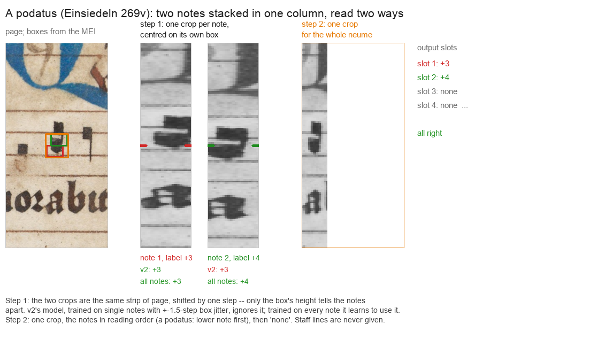
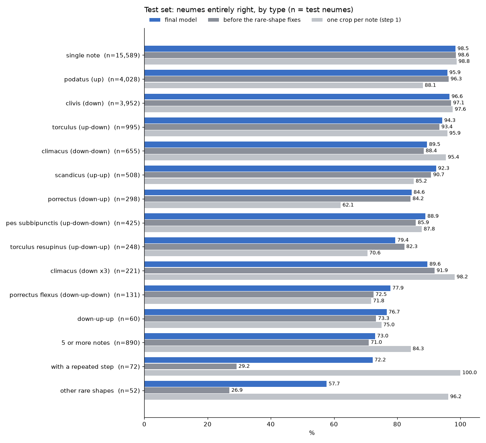
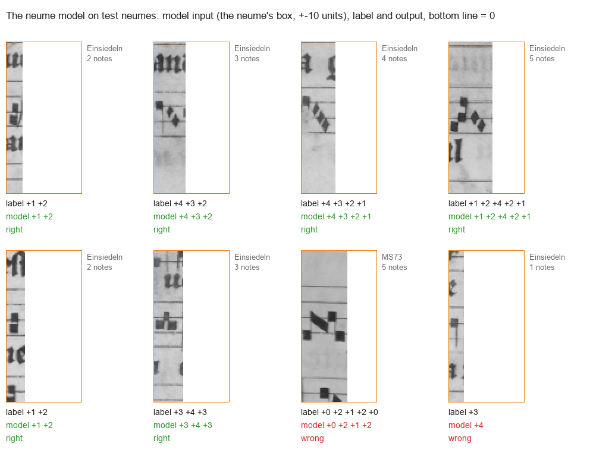
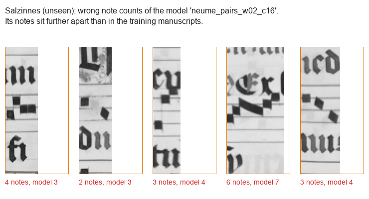

# v3 multi-note neumes: square notation

**Status: first round done** (issue #6). Builds on `../v2-square/`: same pages,
split, labels and crop rules, and no staff lines anywhere.

v2 reads the stave step of a single-note neume from a crop around its box.
Two thirds of all notes are in multi-note neumes. v3 reads those, two ways:

- **Step 1, one crop per note:** each note is cut from its own MEI box and read
  as v2 reads a single note, with v2's model retrained on every note. Needs a
  box per note.
- **Step 2, one crop per neume:** the neume's box, which is what IC actually
  gives. One model outputs how many notes the neume has and the step of each.



Stave step, as in v1 and v2: the bottom staff line is 0, each line up adds 2,
and spaces are odd.

## Layout

| File | Purpose |
|---|---|
| `paths.py` | v3's paths; puts `../v2-square` on the import path (v2's `notes.csv`, crop rules, backbone, augmentation, training loop) |
| `dataset/build_neume_crops.py` | one crop per neume into `data/v3_neumes128/`; `--context` keeps paper around the box for margin jitter (`data/v3_neumes128_ctx/`); `--pairs` makes training pseudo-neumes from neighbouring neumes (`data/v3_neumes128_ctx_pairs/`) |
| `neume_model.py` | `NeumeCNN`: v2's backbone, 8 or 16 horizontal bins, 8 output slots |
| `neume_data.py` | neume crops to model input (margin and spacing jitter on the GPU), slots back to steps |
| `train_notes.py`, `eval_notes.py` | step 1: v2's staff-free model trained on every note; scores per note, per neume, and under box shifts |
| `train_neume.py`, `eval_neume.py` | step 2: `NeumeCNN` (pseudo-neumes and rare-shape sampling as options); scores next to step 1 on the same neumes, and under box errors |
| `eval_salzinnes.py` | both steps on Salzinnes, a manuscript no model was trained on |
| `show_notes.py`, `show_neume_io.py` | figures: inputs and outputs of either step |
| `show_accuracy_by_type.py` | figures: accuracy by neume type and by number of notes; `--compare` puts several models side by side |
| `make_readme_figures.py` | the figures in this README (`figures/readme/`) |

Rendered figures are gitignored (they are drawn on page images from a private
dataset), except those in `figures/readme/`.

## Data

The data are v2's: Einsiedeln and MS73, the same page-level 70 / 15 / 15
split. Every note keeps its own MEI box and label. A neume's box is the union
of its notes' boxes, standing in for IC's glyph box.

Neumes by number of notes (usable, all splits):

| Notes | 1 | 2 | 3 | 4 | 5 | 6 | 7 | 8 | > 8 |
|---|---|---|---|---|---|---|---|---|---|
| Neumes | 107,677 | 52,118 | 15,287 | 7,269 | 3,749 | 1,189 | 185 | 53 | 8 |

| | train | val | test |
|---|---|---|---|
| Neumes (step 2) | 130,977 | 28,421 | 28,124 |
| of which multi-note | 54,759 | 12,553 | 12,535 |
| Notes (step 1, every note) | 217,602 | 48,479 | 48,448 |

Step 2 leaves out the 8 neumes of more than 8 notes, and the 319 neumes with a
note v2 excluded (bad clef line, no box, ...). The final model also trains on
26,084 pseudo-neumes made from neighbouring training neumes (below).

**A fix on the way:** v2 scaled every MS73 page's MEI coordinates by 2. Seven
pages are not at half the image size: 142 (test) is at full size, 40 / 94 / 102
are at 3.23, and 39 / 166 are at 2.01 to 2.04. Page 23's MEI was drawn on
another scan of the page. v2's `build_dataset.py` now scales each page by its
own image size over its MEI size and excludes page 23's notes. v2 was retrained
and its README updated; MS73 test went from 95.6% to 96.6%.

## Step 1: one crop per note

v2's staff-free crop of each note: its own box, 10 units above and below, with
a unit of about one step, at 128 × 32. Before, the models were trained on
single-note neumes only. Now v2's configuration is trained on every note, with
both of v2's box jitters, ±0.5 and ±1.5 steps.

Test set, multi-note neumes (12,535 neumes, 32,859 notes):

| Model | Trained on | Notes right | Stacked notes right | Neumes entirely right | Single-note neumes | Single notes, box 1 step off |
|---|---|---|---|---|---|---|
| v2 staff-based (reference) | single notes | 77.4% | 58.1% | 47.8% | 99.1% | – |
| v2 staff-free, ±0.5 step | single notes | 86.9% | 78.2% | 70.0% | 98.9% | 92.9% |
| v2 staff-free, ±1.5 step (v2's final) | single notes | 80.5% | 66.5% | 56.7% | 98.8% | 98.4% |
| staff-free, ±0.5 step | every note | **97.3%** | **95.9%** | **94.2%** | 98.9% | 81.7% |
| staff-free, ±1.5 step | every note | 95.9% | 93.0% | 90.8% | 98.8% | **98.2%** |

Neumes entirely right, by manuscript: Einsiedeln 97.4% / 93.6%, MS73 64.4% /
64.4% (every-note models, ±0.5 / ±1.5).

- **The error is reading the neighbour.** Of the errors v2's ±0.5-step model
  makes on stacked notes in Einsiedeln, 83% are the step of another note of the
  same neume. Training on every note fixes most of them.
- **Stacked notes are told apart only by the box's height.** Two notes in one
  column give the same strip of page, shifted by a step. A model that reads
  them has to trust the box. The ±0.5-step model does, so it drops to 81.7%
  when the box is off by a step. The staff-based crop uses only the box's
  x-range, so both notes get the same input.
- **Einsiedeln's per-note boxes are as good as it gets.** Their centres sit
  where the pitch puts them: 0.3% are more than 0.75 step off, since Neon
  places them from the pitch. These numbers assume a perfect box per note.
- **MS73's per-note boxes are not.** 51% of its multi-note notes had
  zero-height zones, repaired at their top-left corner. 9.2% share one box
  with another note of their neume, so two notes get one crop.

## Step 2: one crop per neume

**Input:** the neume's box, 10 units above and below its centre, as in v2. The
box's width is kept at true scale (6.4 px per unit) and placed left-aligned on
a white 64-px (10-unit) canvas. Under 0.1% of neumes are wider and get
squeezed. No staff is used.

**Output:** 8 slots in MEI note order, which is reading order (a podatus's
lower note first). Each slot is one of the 13 steps (−3 to +9) or "none". The
number of notes is the number of slots before the first "none".

**Model (`NeumeCNN`):**
- v2's backbone: 3 × 3 convolutions with 16, 32 and 64 channels, and two
  max-pools.
- Pooled to 8 rows × 8 columns instead of v2's 8 × 1, so the notes can be told
  apart from left to right; the final model keeps 16 columns.
- Dropout 0.3, then fully connected 4096 (8192 with 16 columns) → 256 → 8 × 14.
- 1.10 M parameters (2.15 M with 16 columns), almost all in the first fully
  connected layer.
- Loss: cross-entropy summed over the slots.

**Training:** v2's recipe (Adam, lr 1e-3, weight decay 1e-4, batch 128, 30
epochs, v2's augmentation). The epoch kept has the most validation neumes
entirely right. About 30 to 40 minutes per model on a Mac GPU.

The model was improved in three rounds, each aimed at a problem the previous
round showed; the choices were made on the validation set, and Salzinnes was
never used to choose anything.

**Margin jitter:** with the box's edges fixed, a box 0.25 unit wider on each
side pulled a neighbour's ink into the crop. Whole-neume accuracy then fell
from 96% to 77%. From then on the models are trained on context crops and draw
each side's margin from −0.25 to +0.6 units.

**Spacing jitter:** the model also learned how wide a neume of n notes usually
is, and on Salzinnes it miscounted notes that sit further apart (below). The
next models also stretch each neume horizontally by a factor drawn
log-uniformly from ×0.7 to ×1.4. The range is generic (±40%, symmetric in log),
fixed before any Salzinnes score was seen.

**Rare shapes and repeated steps:** by neume type, a shape's accuracy follows
how often it occurs in training. Multi-note test neumes whose contour (up /
down / same, note to note) occurs at least 1,000 times in training are 94%
right; 100 to 999 times, 78%; 20 to 99 times, 38%; under 20 times, 9%.
Neumes with two neighbouring notes on one step make up 0.3% of training
neumes, and 37% of them are read with a note missing. Two fixes:
- **Pseudo-neumes and rare-shape sampling:** two neighbouring neumes on one
  staff, at most 1 unit apart, become one training neume (the union of their
  boxes, their notes in order): 26,084 of them, real ink, many with rare
  contours, repeated steps or 5 to 8 notes. Each epoch then draws its 130,977
  neumes with weight (contour count)^−w, so rare contours make up about a
  third of the samples.
- **16 columns** instead of 8. It was meant for the repeated steps, on the
  guess that two notes side by side on one step share a column; it does
  nothing for them, but helps common shapes a little.

Together, with the lighter weight w = 0.2, they make the final model.



Validation set, neumes entirely right (the set the choices were made on):

| Model | Multi-note | Single-note | With a repeated step | Other rare shapes | 5 or more notes |
|---|---|---|---|---|---|
| + spacing jitter (previous final) | 92.3% | 99.1% | 30% | 35% | 75% |
| + pseudo-neumes, w = 0.3 | 92.3% | 98.7% | 63% | 53% | 80% |
| + 16 columns | 92.4% | 99.2% | 30% | 40% | 74% |
| + pseudo-neumes, w = 0.3, 16 columns | 93.0% | 98.8% | 60% | 59% | 82% |
| **+ pseudo-neumes, w = 0.2, 16 columns (final)** | **93.2%** | **99.1%** | **65%** | **60%** | **82%** |



Test set:

| Model | Single-note neumes right | Multi-note: notes right | Note count right | Neumes entirely right | Einsiedeln | MS73 |
|---|---|---|---|---|---|---|
| ±0.5-step box jitter | 98.9% | 96.1% | 97.7% | 93.5% | 94.1% | 87.3% |
| ±1.5-step box jitter | 98.9% | 96.0% | 97.5% | 93.1% | 93.7% | 87.9% |
| + margin jitter | 98.7% | 95.9% | 97.5% | 93.1% | 93.7% | 87.4% |
| + spacing jitter | 98.6% | 95.2% | 96.7% | 91.8% | 92.6% | 84.9% |
| + pseudo-neumes, w = 0.3 | 98.1% | 95.7% | 97.1% | 92.0% | 92.8% | 84.9% |
| + 16 columns | 98.6% | 95.4% | 96.8% | 92.2% | 92.7% | 86.9% |
| + pseudo-neumes, w = 0.3, 16 columns | 98.2% | 95.8% | 97.6% | 92.6% | 93.2% | 86.8% |
| **+ pseudo-neumes, w = 0.2, 16 columns (final)** | 98.5% | 95.9% | 97.3% | **92.4%** | 93.1% | 85.3% |

The last five columns are multi-note neumes. Each "+" builds on the model
above it, except that the pseudo-neume and 16-column rows all build on
"+ spacing jitter".

- The spacing jitter costs 1.2 points of multi-note neumes entirely right on
  the test set, whose spacing varies little; it pays off on stretched neumes
  (below) and on Salzinnes.
- The rare-shape fixes win back 0.6 of those points overall, and much more on
  what they aim at: neumes with a repeated step 29% → 72%, other rare shapes
  27% → 58%, contours seen 20 to 99 times in training 38% → 60%, under 20 times
  9% → 26%. Common shapes stay where they were, except torculus resupinus
  (82% → 79%): drawing rare shapes more often makes the model a little readier
  to see an extra note.

Final model, multi-note neumes entirely right, by kind: 2 notes 96.2%, 3 notes
91.4%, 4 or more 78.5% (note count right: 92.1%); with stacked notes 89.8%,
ligated 74.6%, with inclinata 84.2%. On MS73 neumes whose notes share one box
it gets 96.0%, where step 1 gets 0.6%.

**Box and spacing errors** (`eval_neume.py --robustness`): all test neumes
entirely right, with the neume's box moved or resized, or the neume stretched
(the first two models take fixed crops, which can't be stretched).

| Box | ±0.5 step | ±1.5 step | + margin jitter | + spacing jitter | final |
|---|---|---|---|---|---|
| as in the MEI | 96.5% | 96.3% | 96.2% | 95.6% | 95.7% |
| 0.5 / 1 step up or down | 95.8% / 92.8% | 96.1% / 95.5% | 95.9% / 95.4% | 95.2% / 94.6% | 95.4% / 95.0% |
| 0.25 / 0.1 unit narrower each side | 92.6% / 96.1% | 91.2% / 95.7% | 95.8% / 96.2% | 95.3% / 95.6% | 95.6% / 95.8% |
| 0.1 / 0.25 unit wider each side | 95.9% / 87.9% | 95.8% / 76.8% | 95.9% / 95.1% | 95.4% / 94.7% | 95.4% / 94.2% |
| 0.5 unit wider each side | 25.9% | 19.7% | 81.3% | 91.3% | 89.2% |
| neume stretched ×0.8 / ×1.25 | – | – | 93.4% / 92.1% | 95.0% / 95.1% | 95.5% / 95.1% |

The pseudo-neumes teach the model that ink inside the box belongs to the neume,
which costs 2 points when the box takes in half a unit of a neighbour on each
side.

**Step 1 and step 2 on the same neumes** (multi-note, entirely right): on
Einsiedeln, step 2 gets 93.1% against step 1's 97.4% (±0.5) and 93.6% (±1.5),
without a box per note. Most of the gap is in long neumes and ligatures. On
MS73, step 2 gets 85.3% and step 1 64.4%: one box per neume sidesteps MS73's
bad per-note boxes.

## Unseen manuscript: Salzinnes

Salzinnes (CDN-Hsmu M2149.L4): the same 6 pages and MEI reading as v2's
`eval_ood.py`. That is 1,011 neumes, 437 of them multi-note, and 1,758 notes.
It is a test only: nothing was tuned on it.

| Model | Single-note neumes right | Multi-note: notes right | Note count right | Neumes entirely right |
|---|---|---|---|---|
| step 1, v2's final (single notes) | 100% | 94.8% | – | 86.7% |
| step 1, every note, ±0.5 step | 100% | 99.6% | – | 98.9% |
| step 1, every note, ±1.5 step | 100% | 98.9% | – | 97.0% |
| step 2, ±0.5 step | 100% | 92.0% | 89.2% | 80.8% |
| step 2, ±1.5 step | 99.8% | 91.4% | 89.7% | 80.6% |
| step 2, + margin jitter | 99.7% | 90.2% | 87.0% | 76.4% |
| step 2, + spacing jitter | 100% | 92.2% | 91.5% | 84.0% |
| step 2, + pseudo-neumes, w = 0.3 | 99.8% | 95.1% | 95.4% | 89.7% |
| step 2, + 16 columns | 100% | 93.8% | 92.7% | 86.5% |
| step 2, + pseudo-neumes, w = 0.3, 16 columns | 99.7% | 94.5% | 95.0% | 88.1% |
| **step 2, final** | 100% | 94.9% | 95.0% | **88.3%** |

The last three columns are multi-note neumes.

Step 1 carries over. Salzinnes' boxes, like Einsiedeln's, were placed by Neon
from the pitch. Without spacing jitter, step 2 dropped from 93% to 76–81%,
mostly on the note count. A Salzinnes neume is wider: 2.5 units for 2 notes and
6.9 for 5, against 2.0 and 5.0 in Einsiedeln. The model overcounted short
neumes (22 of 264 two-note neumes read as three) and undercounted long ones.
Spacing jitter lifts it to 84.0%, and the rare-shape fixes to 88.3%, with the
note count right 95.0% of the time.

Notes of the neighbouring staff are not the cause. Another staff's lines fall
inside the crop for 94.5% of Salzinnes neumes, but also for 97.0% of
Einsiedeln's and 91.6% of MS73's.



## Takeaways

- Trained on multi-note neumes, the staff-free approach reads them.
  - With a box per note, 97% of notes are right.
  - With one box per neume, 96% of notes and 92% of whole neumes are right,
    and single-note neumes stay at 98.5%.
- With one box per note, stacked notes force a choice: trust the box's height,
  or be robust to box errors. One box per neume avoids the choice, since order
  tells the notes apart.
- The neume model learns what it sees most: how wide a neume is, where its
  edges are, and which shapes are common.
  - Margin jitter fixes the edges.
  - Spacing jitter makes it count notes rather than measure width.
  - Pseudo-neumes and rare-shape sampling make rare shapes less rare: neumes
    with a repeated step go from 29% to 72%.
  - Salzinnes rises from 76% to 88% along the way.

## Limitations and next steps

- **Real IC boxes.** These are MEI boxes, not IC boxes. IC may also split or
  merge glyphs differently from the MEI's neumes. Next: run IC on test pages,
  match its glyphs to MEI neumes, measure the real box error and set the margin
  jitter from it.
- **Rare shapes.** Still around 60%, against 90% and more for common shapes;
  step 1, which reads note by note, gets 96% to 100% on them. Next: an output
  that finds notes left to right (or detects noteheads first) instead of
  filling fixed slots, so no shape has to be learned whole.
- **New manuscripts.** Step 2 is at 88% on Salzinnes, against 92% on the test
  set and 97% for step 1 with a box per note; more manuscripts would help.
- **Long neumes and ligatures** (4 or more notes: 79%; ligated: 75%).
- **Pitch.** The step is evaluated, not the pitch. The clef still comes from
  the annotation.
- **Comparison.** No comparison yet with the heuristic pitch finder on
  multi-note neumes.

## Reproducing

v2's data first (`../v2-square/README.md`: `fetch_sources.py`,
`build_dataset.py`). Then, from this folder:

```
cd ../v2-square/dataset && python build_crops.py --mode bbox --img-h 128   # every note: a superset of v2's cache
cd ../../v3-multinote/dataset
python build_neume_crops.py
python build_neume_crops.py --context
python build_neume_crops.py --pairs
cd ..
python train_notes.py
python train_neume.py
python eval_notes.py && python eval_notes.py --robustness
python eval_neume.py && python eval_neume.py --robustness
python eval_salzinnes.py   # Salzinnes MEI and images: see ../v2-square/eval_ood.py
python make_readme_figures.py
python show_accuracy_by_type.py   # by-type figures (figures/, not committed)
```

`checkpoints/` already holds the trained weights, so the evaluation scripts
run without retraining.
